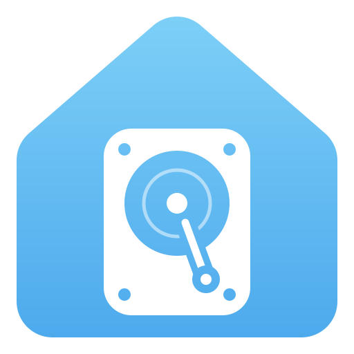

<p align="center"></p>

<h1 align="center">NAS Assistant</h1>

<p align="center">Your family cloud, at home, inside Home Assistant.</p>

A local alternative to iCloud Family Sharing: every Home Assistant user gets a private space,
plus a folder shared with the whole family, on a dedicated disk of your choice.

- 🔒 A private space for every HA user, no new accounts
- 🖼️ Apple-style photo and video gallery: monthly timeline, full-screen viewer, iPhone HEIC photos
- 👨‍👩‍👧 Shared Family folder
- 🗂️ Files catalogued by type (photos, videos, music, documents, archives); rename and move with a menu or drag and drop
- ♻️ Recently deleted: undo, restore to the original folder, or delete forever
- 💽 Dedicated disk, any size: HA backups stay on the main disk
- 🧷 Uses your disk as is (ext4, exFAT, NTFS): nothing is formatted unless you ask
- ⏯️ Resumable uploads that survive dropped connections and large videos
- 🌍 Speaks your language: follows your Home Assistant profile (English, Italiano, Español, Français, Deutsch)
- 📱 iOS and Android apps with automatic photo backup (coming soon)
- 🏠 Everything stays local

## Installation

[](https://my.home-assistant.io/redirect/supervisor_add_addon_repository/?repository_url=https%3A%2F%2Fgithub.com%2Fovlas%2Fnas-assistant)

1. Settings → Add-ons → Add-on Store → ⋮ → Repositories → add `https://github.com/ovlas/nas-assistant`
2. Install **NAS Assistant** and start it
3. Open **NAS Assistant** from the sidebar and choose the disk

Full guide: [nas_assistant/DOCS.md](nas_assistant/DOCS.md) · Architecture and roadmap: [docs/ARCHITECTURE.md](docs/ARCHITECTURE.md)

## Translations

The UI picks the language of your Home Assistant profile, then your browser's, then English.
To add a language, copy the `en` block in [`nas_assistant/web/i18n.js`](nas_assistant/web/i18n.js)
and add a file in [`nas_assistant/translations/`](nas_assistant/translations) for the add-on options. Pull requests welcome!

## Local development

```bash
cd nas_assistant
pip install -r app/requirements.txt
NAS_ROOT=/tmp/nas NAS_DEV_TRUSTED_IP=127.0.0.1 python -m uvicorn app.main:app --port 8456
curl -H "X-Remote-User-Id: test" http://127.0.0.1:8456/api/me
```

License: MIT
