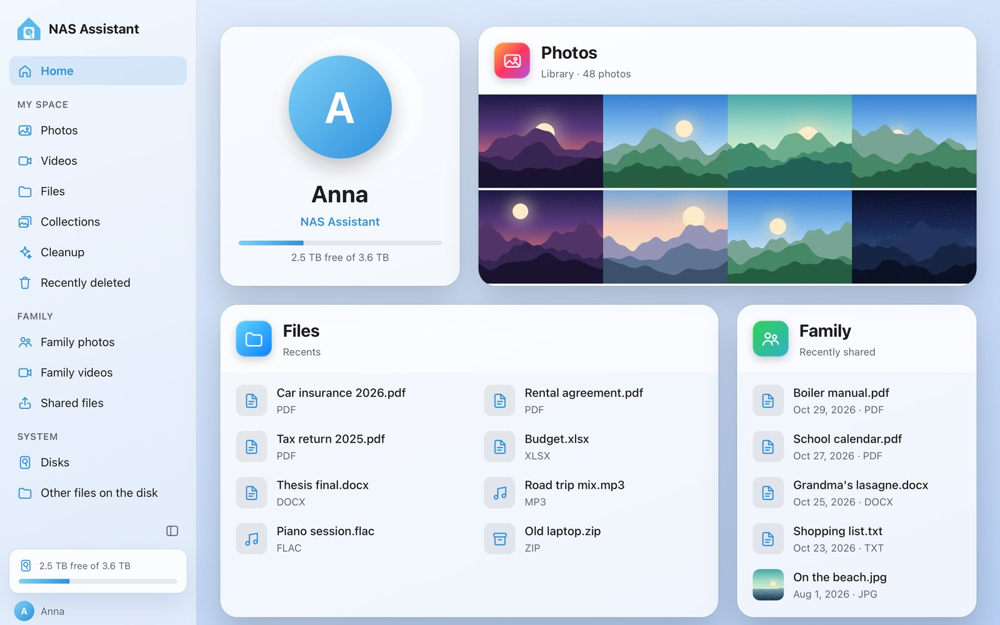
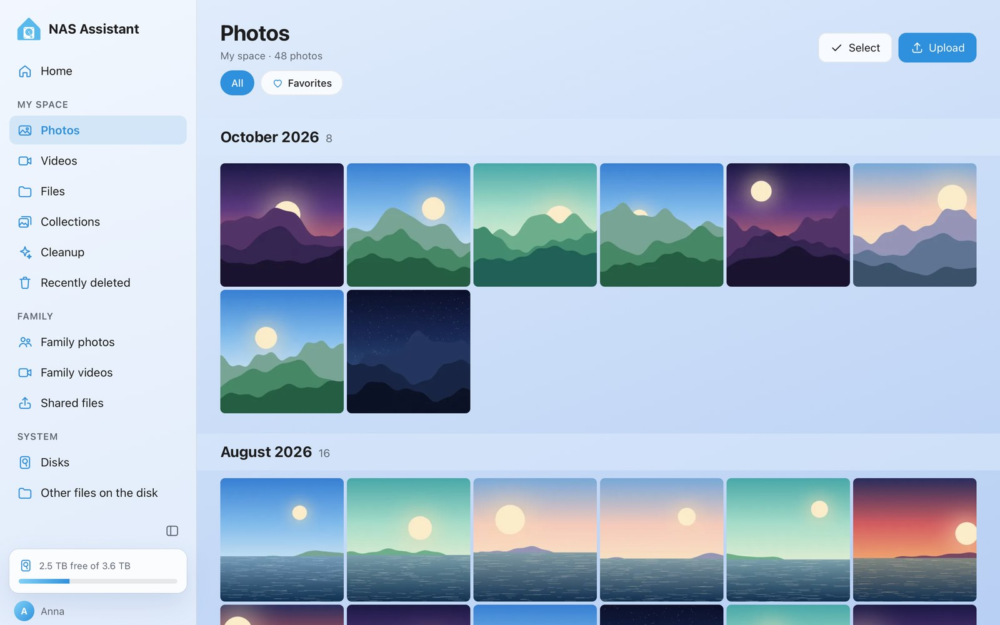
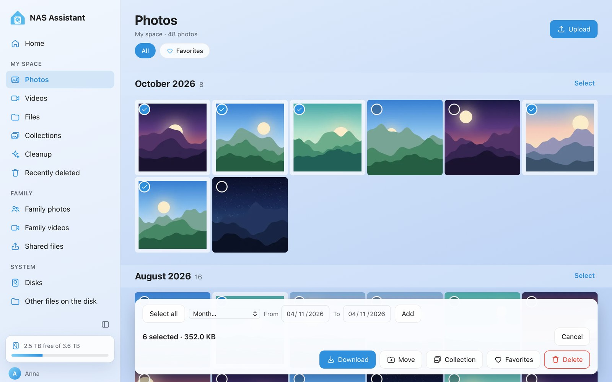
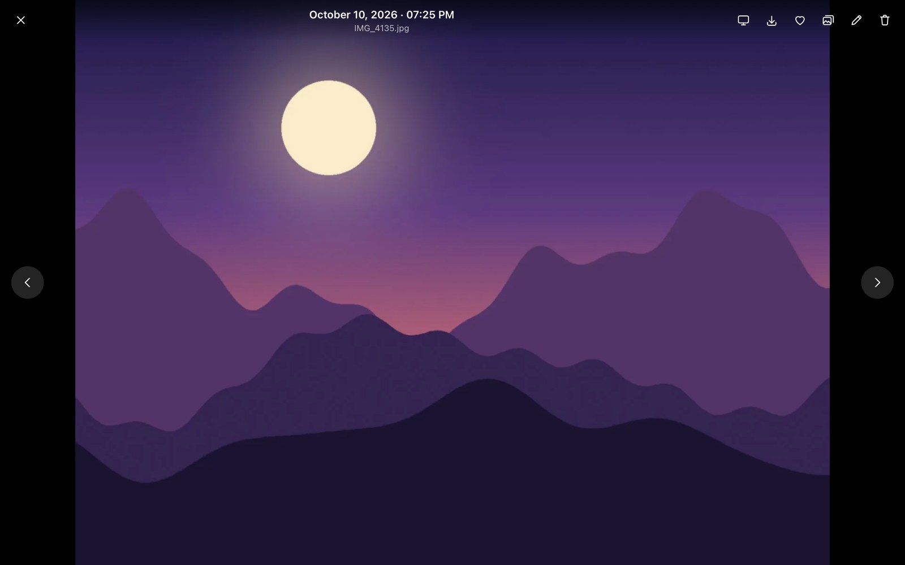
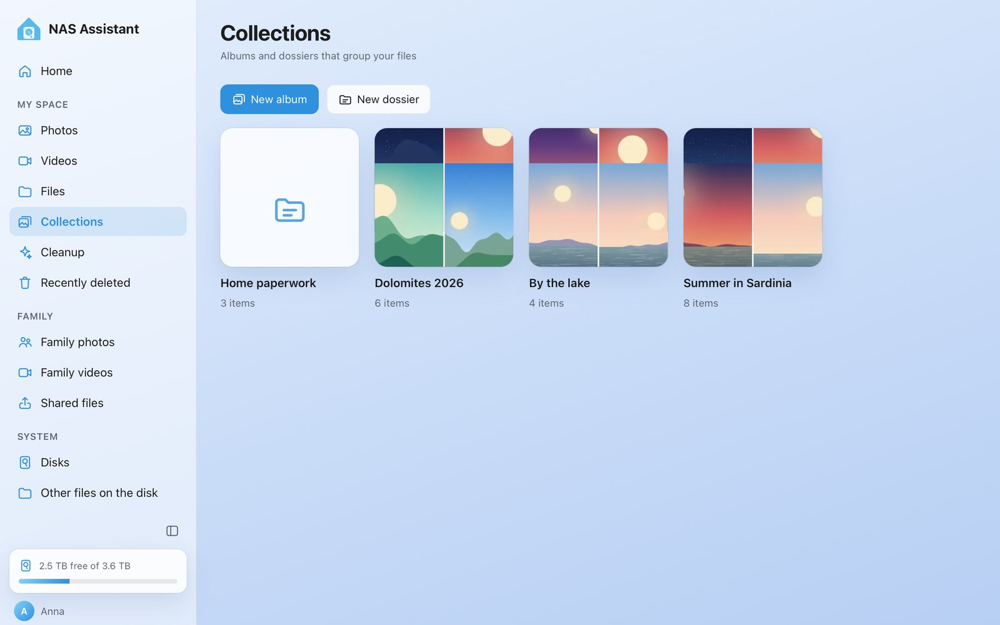
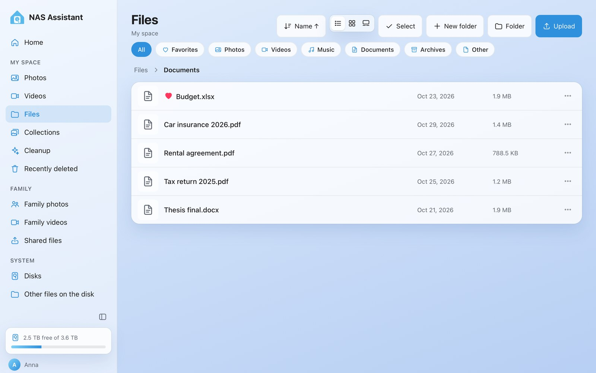
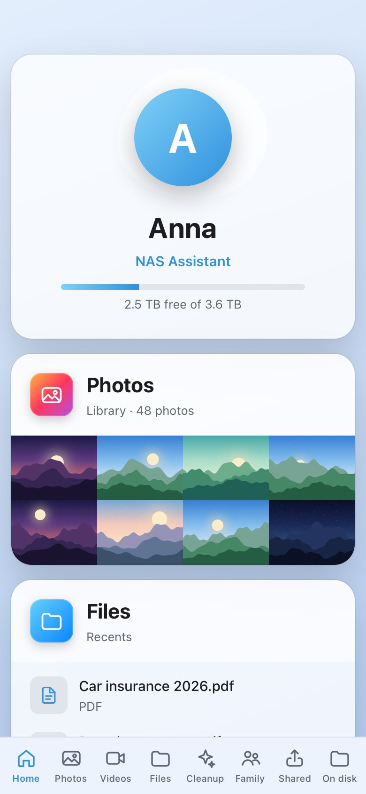
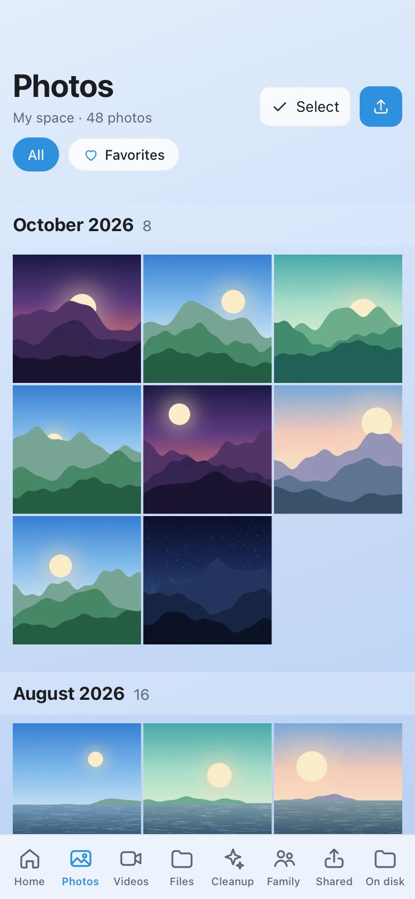
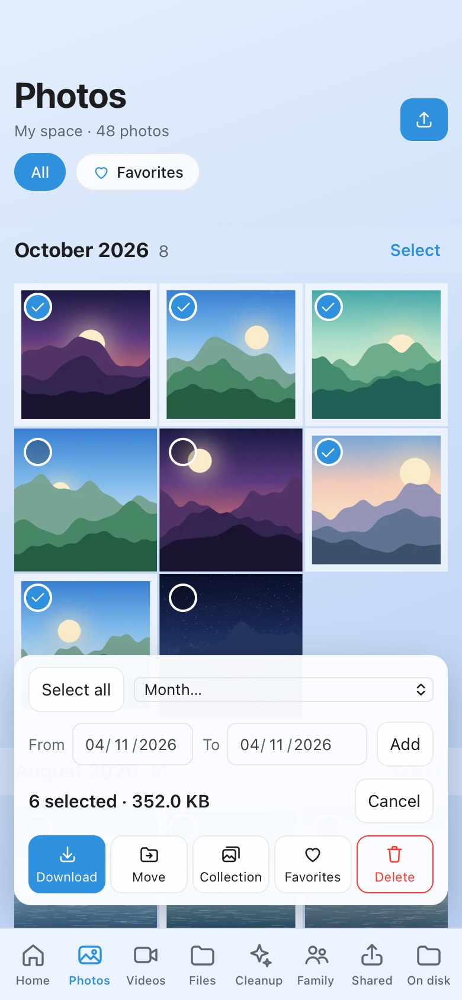

<p align="center"></p>

<h1 align="center">NAS Assistant</h1>

<p align="center">Your family cloud, at home, inside Home Assistant.</p>

A local alternative to iCloud Family Sharing: every Home Assistant user gets a private space,
plus a folder shared with the whole family, on a dedicated disk of your choice.

<p align="center"></p>

- 🔒 A private space for every HA user, no new accounts
- 🏠 iCloud-style welcome page: storage, latest photos, recent files, family activity
- 🖼️ Apple-style photo and video gallery: monthly timeline, full-screen viewer, iPhone HEIC photos
- 👨‍👩‍👧 Shared Family folder
- 🗂️ Collections: photo albums and document dossiers, personal or shared with the family
- ❤️ Favorites for photos, videos, files and folders
- 🗂️ Files catalogued by type (photos, videos, music, documents, archives); rename and move with a menu or drag and drop
- ♻️ Recently deleted: undo, restore to the original folder, or delete forever
- 🔌 Plug and play: known disks are taken back by themselves, new ones announced with a Home Assistant notification
- 📡 TVs of the house: the TV finds NAS Assistant among its sources (DLNA, Family only, off by default)
- 📺 Watch on the TV: photos, videos and slideshows on any TV Home Assistant knows (Cast, Samsung, LG, Apple TV…)
- 🗂️ Other files on the disk: browse what was already on a disk (read only) and copy it into My space or Family
- 💽 Disks page: give a new disk a role (nightly backup, or extra storage joined to the NAS) and change it any time; initialize it only if you decide; no need to turn off protection mode
- 🛡️ Add a second disk and nightly backups unlock: incremental copies with 30 days of previous versions
- 💽 Dedicated disk, any size: HA backups stay on the main disk
- 🧷 Uses your disk as is (ext4, exFAT, NTFS): nothing is formatted unless you ask
- ⏯️ Resumable uploads that survive dropped connections and large videos
- 🌍 Speaks your language: follows your Home Assistant profile (English, Italiano, Español, Français, Deutsch)
- 📲 Background uploads from the iPhone with an iOS Shortcut (Share menu or nightly automation)
- 📱 [iPhone and Android app](https://github.com/ovlas/nas-assistant-app) with automatic camera-roll backup, paired with a one-time QR code (early version, not in the stores yet)
- 🏠 Everything stays local

## Screenshots

<table>
  <tr>
    <td width="50%"><br><b>Photos</b>: a monthly timeline of everything on the disk</td>
    <td width="50%"><br><b>Select</b>: pick many items, then download, move, collect, favorite or delete them</td>
  </tr>
  <tr>
    <td><br><b>Viewer</b>: full screen, with favorites, albums and watching on the TV</td>
    <td><br><b>Collections</b>: albums and dossiers, personal or shared with the family</td>
  </tr>
  <tr>
    <td colspan="2"><br><b>Files</b>: folders, types and favorites</td>
  </tr>
</table>

Made for the phone too:

<p align="center">
  
  
  
</p>

<sub>Screenshots use demo data: the pictures are drawn for the occasion, the documents are dummies and the disk size is simulated.</sub>

## Installation

[](https://my.home-assistant.io/redirect/supervisor_add_addon_repository/?repository_url=https%3A%2F%2Fgithub.com%2Fovlas%2Fnas-assistant)

1. Settings → Add-ons → Add-on Store → ⋮ → Repositories → add `https://github.com/ovlas/nas-assistant`
2. Install **NAS Assistant** and start it
3. Open **NAS Assistant** from the sidebar and choose the disk

Full guide: [nas_assistant/DOCS.md](nas_assistant/DOCS.md) · Architecture and roadmap: [docs/ARCHITECTURE.md](docs/ARCHITECTURE.md)

## Translations

The UI picks the language of your Home Assistant profile, then your browser's, then English.
To add a language, copy the `en` block in [`nas_assistant/web/i18n.js`](nas_assistant/web/i18n.js)
and add a file in [`nas_assistant/translations/`](nas_assistant/translations) for the add-on options. Pull requests welcome!

## Local development

```bash
cd nas_assistant
pip install -r app/requirements.txt
NAS_ROOT=/tmp/nas NAS_DEV_TRUSTED_IP=127.0.0.1 python -m uvicorn app.main:app --port 8456
curl -H "X-Remote-User-Id: test" http://127.0.0.1:8456/api/me
```

License: MIT
